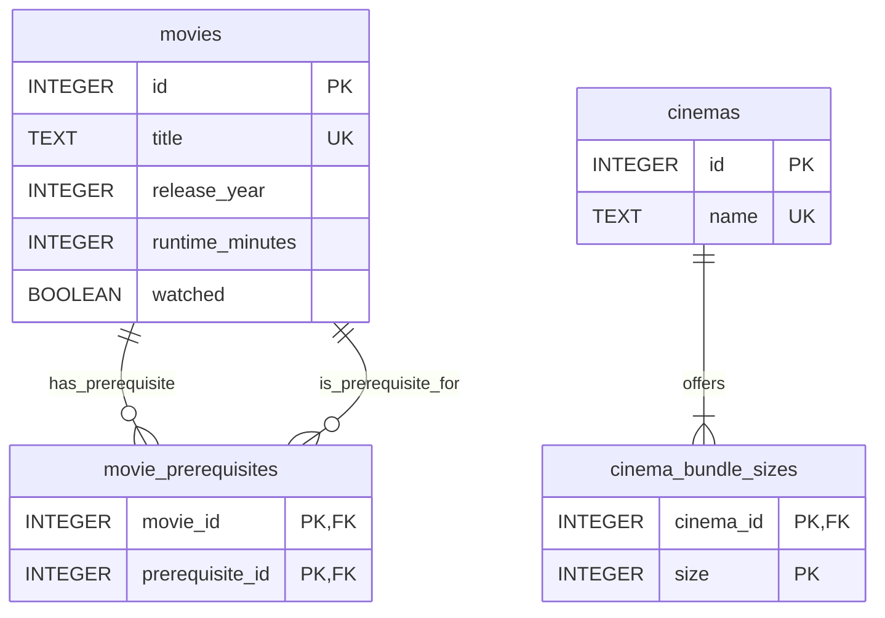

# Doomsday Ready

Doomsday Ready is an MCU rewatch planner and cinema watch-party booking app. Add movies and prerequisite relationships, build a viewing order for a target film, track watched progress, and calculate the smallest exact set of cinema seat bundles for a group.

## Tech stack

- **Backend:** Node.js 22, Express, TypeScript, SQLite with `better-sqlite3`
- **Frontend:** React, Vite, TypeScript, React Router, CSS Modules
- **Tests:** Vitest and Supertest
- **Containers:** Docker Compose, Node-based API container, Nginx static frontend and API proxy

The frontend and backend are separate npm projects. `better-sqlite3` is pinned in `backend/package.json`; the backend Docker image uses Node 22 on Debian so native installation can use prebuilt binaries or compile with build tools when needed.

## Run locally

Use Node.js 22 or newer and npm. Start the backend in one terminal:

```sh
cd backend
npm ci
```

Copy the example environment file if you want to change the defaults:

```sh
cp .env.example .env
npm run dev
```

In PowerShell, use `Copy-Item .env.example .env` instead of `cp`. The API defaults to `http://localhost:3000`; the default SQLite file is `backend/data/doomsday-ready.db` when commands run from the backend directory.

Start the frontend in a second terminal:

```sh
cd frontend
npm ci
npm run dev
```

Vite serves the app at `http://localhost:5173` and proxies `/api` to `http://localhost:3000`.

### Seed, tests, and builds

Run these commands from `backend/`:

```sh
npm run seed
npm test
npm run build
```

The seed command inserts the sample MCU movies and cinemas. Existing movie titles and cinema names are skipped, so rerunning it does not overwrite data.

Run frontend checks from `frontend/`:

```sh
npm run typecheck
npm run build
```

## Run with Docker

From the repository root:

```sh
docker compose up --build
```

Open `http://localhost:8080`. Nginx serves the built frontend and proxies `/api` requests to the backend. The API is also available on `http://localhost:3000`. SQLite is stored in the named Compose volume `doomsday-data`, mounted at `/data` inside the backend container.

Seed the Docker database with:

```sh
docker compose exec backend node dist/src/scripts/seed.js
```

Stop containers with `docker compose down`. The named database volume remains. `docker compose down -v` also removes that volume and its data.

## API reference

All API routes use the `/api` prefix. Request and response bodies are JSON. Error responses use `{ "error": { "code": "...", "message": "..." } }`.

| Method and path | Example request | Example response |
| --- | --- | --- |
| `GET /api/health` | — | `200 { "status": "ok" }` |
| `GET /api/movies` | — | `200 [{ "id": 1, "title": "Iron Man", "releaseYear": 2008, "runtimeMinutes": 126, "watched": false, "prerequisiteIds": [] }]` |
| `POST /api/movies` | `{ "title": "Iron Man", "releaseYear": 2008, "runtimeMinutes": 126, "prerequisiteIds": [] }` | `201 { "id": 1, "title": "Iron Man", "releaseYear": 2008, "runtimeMinutes": 126, "watched": false, "prerequisiteIds": [] }` |
| `PATCH /api/movies/:id` | `{ "watched": true, "prerequisiteIds": [2, 3] }` | `200` with the updated movie object |
| `GET /api/movies/:id/rewatch-order` | — | `200 { "target": { "id": 7, "title": "Avengers: Endgame" }, "order": [{ "id": 1, "title": "Iron Man", "releaseYear": 2008, "runtimeMinutes": 126, "watched": true, "prerequisiteIds": [] }], "watchedCount": 1, "totalCount": 1, "remainingRuntimeMinutes": 0 }` |
| `GET /api/cinemas` | — | `200 [{ "id": 1, "name": "Downtown Cinema", "bundleSizes": [1, 3, 4] }]` |
| `POST /api/cinemas` | `{ "name": "Downtown Cinema", "bundleSizes": [1, 3, 4] }` | `201 { "id": 1, "name": "Downtown Cinema", "bundleSizes": [1, 3, 4] }` |
| `GET /api/cinemas/:id/booking?groupSize=6` | — | `200 { "cinemaId": 1, "groupSize": 6, "possible": true, "totalBundles": 2, "breakdown": [{ "size": 3, "count": 2 }] }` |
| `GET /api/cinemas/:id/booking?groupSize=7` | — | `200 { "cinemaId": 1, "groupSize": 7, "possible": false, "message": "No exact combination possible" }` |

Movies require a nonblank title and a runtime from 1 to 300 minutes. Prerequisite IDs must refer to existing movies; self-dependencies and circular dependencies return `409 CIRCULAR_DEPENDENCY`. Movie titles and cinema names must be unique (`409 DUPLICATE_TITLE` and `409 DUPLICATE_NAME`). Cinema bundle sizes must be 1–10 distinct integers from 1 to 500. Booking group sizes must be integers from 1 to 10,000. Rewatch-order requests for unknown movies return `404 MOVIE_NOT_FOUND`; booking requests for unknown cinemas return `404 CINEMA_NOT_FOUND`.

## Data model



Both foreign keys in `movie_prerequisites` reference `movies.id`; deleting a movie cascades to its prerequisite edges. Cinema bundle rows also cascade when their cinema is deleted. SQLite foreign-key enforcement is enabled by the backend.

## Algorithms

### Cycle detection

The graph stores each movie's outgoing prerequisite edges. Before a proposed prerequisite list is saved, an iterative depth-first traversal starts from those prerequisites and follows their prerequisite edges. If it reaches the movie being changed, the proposal would close a cycle. A visited set prevents repeated traversal of shared paths.

- **Time:** `O(V + E)` in the traversed graph
- **Space:** `O(V)` for the visited set and traversal stack

### Rewatch order

The planner performs iterative depth-first search from the target's prerequisites and adds each movie after visiting its own prerequisites (post-order). A completed set ensures shared prerequisites, such as a diamond-shaped dependency, appear only once. The target is excluded from its own order.

- **Time:** `O(V + E)` for the reachable prerequisite subgraph
- **Space:** `O(V)` for traversal state and the result

### Cinema booking quote

The quote uses bottom-up minimum coin change. For each group size from 1 through the requested total, dynamic programming stores the fewest bundles needed and the last bundle size used. Following those stored sizes reconstructs an exact minimum-bundle breakdown. It is an unbounded combination: any available bundle size can be used repeatedly.

- **Time:** `O(G × B)`, where `G` is group size and `B` is the number of available sizes
- **Space:** `O(G)` for the best-count and reconstruction arrays

The supported bounds (`G ≤ 10,000`, `B ≤ 10`) keep this calculation small.

## Assumptions and choices

- Movie runtime is recorded in whole minutes (1–300). `remainingRuntimeMinutes` sums only unwatched movies in the prerequisite list; it does not include the target movie. `watchedCount` and `totalCount` also refer to prerequisites only.
- Supplying `prerequisiteIds` in a movie PATCH replaces the full prerequisite list. Omitting it leaves the list unchanged.
- Prerequisite cycles and invalid or duplicate request data are rejected before writes. Related records are saved transactionally, so rejected requests do not leave partial movie/prerequisite or cinema/bundle rows.
- Duplicate movie titles and cinema names are checked without regard to letter case by the API.
- A cinema booking is possible only when the group can be matched exactly. The result minimizes the number of bundles and does not approximate when no exact match exists.
- The seed process skips an existing movie or cinema by title/name and does not overwrite its current details.
- Authentication and payment processing are outside this project’s current scope.

## How I used AI tools

Codex was used to scaffold the project and generate code and tests. I reviewed, ran, and tested the resulting work myself.
